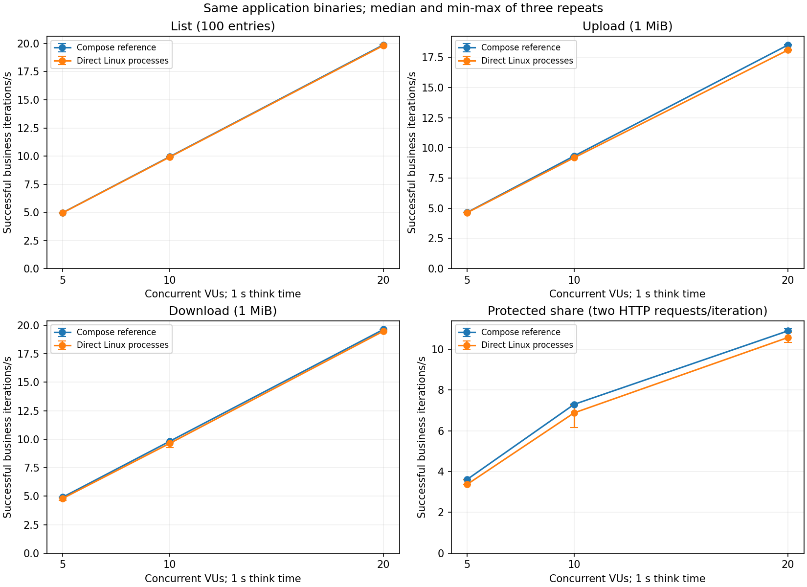
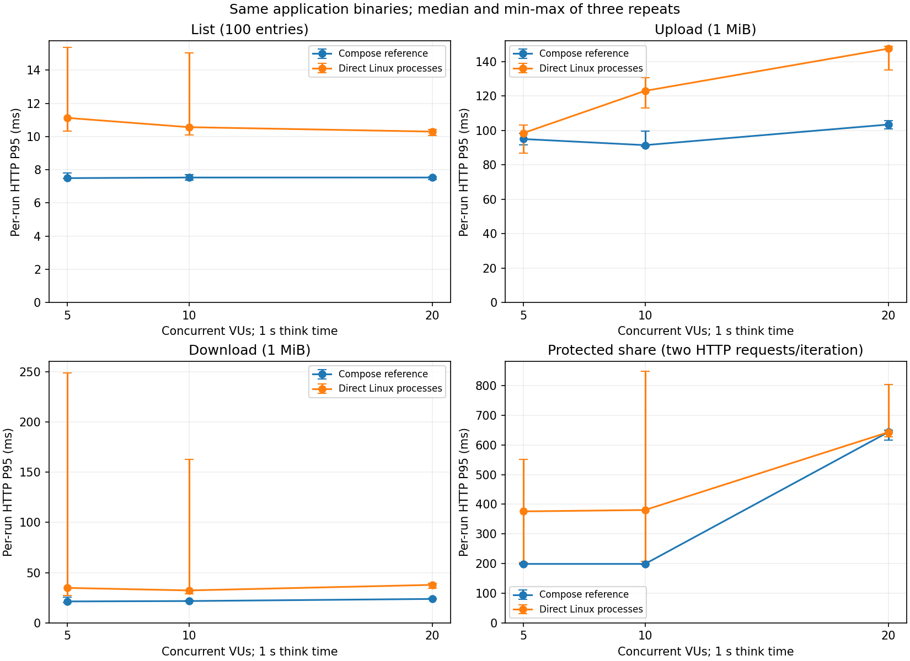
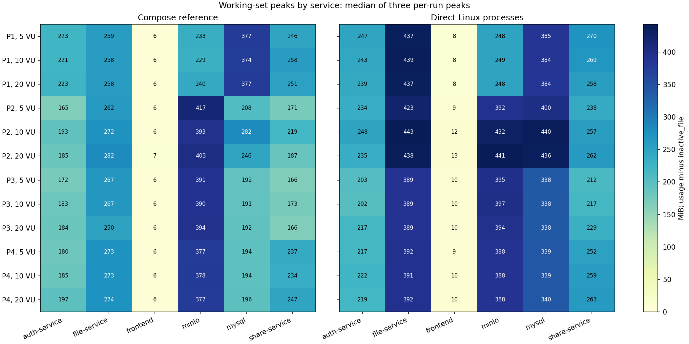
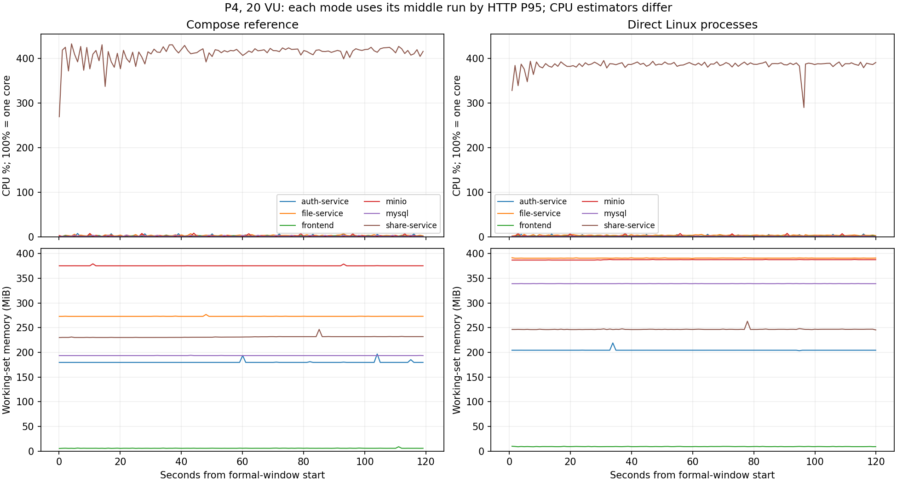

# 实验一：Docker Compose 与非容器部署的性能对照

测试日期：2026 年 11 月 16 日。六容器方案与非容器方案均完成 P1—P4 的 36 轮矩阵，P5 按本轮安排排除。

在本机记录的部署条件下，20 VU 时非容器方案的业务吞吐比容器方案低 0.3%—3.0%。列表、上传和下载的 HTTP P95 中位数在容器方案中更低；分享访问在 20 VU 下均约为 643 ms，主要 CPU 消耗集中在分享服务。非容器方案的部分重复轮次波动较大，下面保留三次结果的完整范围。

容器基础实验记录 52,371 次正式请求，14 次失败；非容器记录 51,200 次，18 次失败。两侧均无请求超时，失败均为 HTTP 503、`DEPENDENCY_UNAVAILABLE`。两侧各 840 次轮前、轮后种子文件 SHA-256 校验全部一致。

## 1. 对照方案与来源

非容器方案是在专用 WSL2 发行版中直接运行 Nginx、认证服务、文件服务、分享服务、MySQL 和 MinIO。六个服务分别进入只用于记账的 cgroup，不设置单服务 CPU 或内存限额。正式测量期间 Docker Desktop 停止运行，业务由普通 Linux 进程提供。两侧都使用 WSL2 虚拟化环境。

| 项目 | 六容器方案 | 非容器方案 |
| --- | --- | --- |
| 主机 | Windows 11，Intel Core Ultra 9 285H，16 个逻辑处理器，约 31.50 GiB 内存 | 同一台主机 |
| CPU、内存预算 | 4 CPU；WSL 配置 4 GiB，实际可用 4,107,522,048 字节，约 3.83 GiB | 相同；正式批次实际可用字节数一致 |
| 运行环境 | Docker Desktop，Docker 29.9.2，Compose 5.6.1，WSL2 | `CloudDrive-E1-Native`，Ubuntu 26.04.1，WSL2 6.6.87.2 |
| 请求入口 | Windows `127.0.0.1:8080` → Docker 发布端口 → Nginx → 服务网络 | Windows `127.0.0.1:18080` → WSL 转发 → Nginx → Linux loopback |
| 数据盘 | C 盘上的 Docker VHDX，MySQL/MinIO 命名卷 | D 盘上的专用 WSL ext4 VHDX |
| 存储设备 | C、D 分区同属物理磁盘 0 | 同左 |
| 负载工具 | Windows Python 3.13.5、requests 2.32.4，闭环虚拟用户 | 复用相同请求与业务负载代码 |
| 每用户数据 | 列表目录 100 项，独立账号和上传目录，1 MiB 种子文件 | 相同逻辑数据布局与文件内容 |
| 准备完成时文件表总记录 | 2,691，包含历史及已删除记录 | 3,190，包含历史及已删除记录 |

原生程序直接从 E1 冻结镜像提取，没有重新编译业务代码。JRE 为 Temurin 17.0.21+9，MySQL 为 8.0.29，Nginx 为 1.28.3，MinIO 为 `RELEASE.2025-09-07T16-13-09Z`。三个后端沿用默认 JVM 启动方式，估算最大堆约 980 MiB。认证与文件镜像内的 JRE 逐文件一致，原生侧共用该 JRE。

[程序一致性核对](../../experiments/E1/20261116-e1-native-formal-summary/binary-equivalence.json)验证了三个 JAR、MySQL、MinIO、Nginx 主程序及全部前端文件。原生端口、数据库连接、Nginx 配置及脱敏环境变量见[配置快照](../../experiments/E1/20261116-e1-native-formal-summary/configuration.redacted.json)。SQL 结构、JWT 契约和业务代码保持原样，私有凭证单独生成并保存在仓库之外。

| 正式批次 | 使用范围 | 测量代码提交 | 追溯入口 |
| --- | --- | --- | --- |
| `20261116-e1-formal-ipv4` | 容器 P1—P3，共 27 轮 | `5fb0392` | [清单](../../experiments/E1/20261116-e1-formal-ipv4-summary/matrix.json) |
| `20261116-e1-continuation` | 容器 P4，共 9 轮；本次排除其中 P5 | `5186da2` | [清单](../../experiments/E1/20261116-e1-continuation-summary/matrix.json) |
| `20261116-e1-native-formal` | 原生 P1—P4，共 36 轮 | `3ca1241` | [清单](../../experiments/E1/20261116-e1-native-formal-summary/matrix.json)、[环境](../../experiments/E1/20261116-e1-native-formal-summary/environment.json) |

原生正式窗口从北京时间 19:26 至 21:22，包含轮间预热、校验、清理与冷却间隔。原生环境先通过 86/86 项 API 冒烟和四类短试跑。此前两个准备试跑分别因 WSL shell 二次展开、过严的可用内存字节相等检查而中止，记录保留在对应 pilot 目录，未进入正式统计。正式批次内存实际值与容器参照相同。

## 2. 工作负载与统计口径

P1 为目录列表；P2 为 1 MiB 上传；P3 为 1 MiB 个人下载；P4 为受保护分享访问，一次业务迭代依次进行匿名提取码验证和匿名下载，正常包含两次 HTTP 请求。

每个场景设置 5、10、20 VU，各重复三次。三次并发顺序分别为 5→10→20、10→20→5、20→5→10。每轮预热 30 秒、测量 120 秒、冷却至少 30 秒，并检查资源恢复稳定。每个用户完成一次业务迭代后等待 1 秒。每轮重新登录，登录与凭证检查、源文件校验、上传清理均在正式窗口之外。P2 每用户含预热最多上传 150 次，全部轮次均未触及上限。

HTTP 延迟从准备好的请求发出到完整响应体接收结束；multipart 编码与正文校验在此计时之外。业务迭代耗时包含请求准备和业务步骤，不包含之后的 1 秒等待。正式窗口内发起的失败、超时和晚完成请求保留在成功率分母中；吞吐量计窗口内完成的成功业务迭代。P1—P3 每次迭代只有一次请求，因此业务与 HTTP 吞吐相同。P4 另行保留 HTTP 吞吐，不能直接与其业务吞吐混用。

每轮独立计算均值、P50、P95、P99，三次重复汇总取中位数和最小—最大范围。下表为业务迭代吞吐与 HTTP P95；完整请求数、成功率、P99、字节吞吐及逐轮值见[原生逐轮表](../../experiments/E1/20261116-e1-native-formal-summary/per-round.csv)、[原生重复汇总](../../experiments/E1/20261116-e1-native-formal-summary/aggregate.csv)与[两侧对照表](../../experiments/E1/20261116-e1-native-formal-summary/comparison.csv)。

## 3. 性能结果

P95 单位为 ms，方括号表示三次重复的最小—最大值；吞吐单位为成功业务迭代/s。

| 场景 | VU | 容器吞吐 | 原生吞吐 | 容器 HTTP P95 [范围] | 原生 HTTP P95 [范围] |
| --- | ---: | ---: | ---: | --- | --- |
| P1 列表 | 5 | 4.975 | 4.958 | 7.49 [7.47—7.81] | 11.12 [10.34—15.36] |
| P1 列表 | 10 | 9.942 | 9.908 | 7.53 [7.36—7.70] | 10.56 [10.09—15.03] |
| P1 列表 | 20 | 19.883 | 19.825 | 7.53 [7.41—7.56] | 10.30 [10.05—10.43] |
| P2 上传 | 5 | 4.658 | 4.633 | 94.94 [91.67—98.42] | 98.42 [86.76—102.97] |
| P2 上传 | 10 | 9.325 | 9.183 | 91.38 [90.46—99.48] | 122.92 [112.94—130.65] |
| P2 上传 | 20 | 18.517 | 18.100 | 103.35 [100.90—105.64] | 147.43 [135.04—148.83] |
| P3 下载 | 5 | 4.917 | 4.808 | 21.37 [20.38—25.77] | 34.83 [27.23—248.86] |
| P3 下载 | 10 | 9.817 | 9.633 | 21.75 [21.30—22.19] | 32.32 [29.04—162.75] |
| P3 下载 | 20 | 19.633 | 19.483 | 23.85 [23.23—24.65] | 37.83 [34.60—39.61] |
| P4 分享 | 5 | 3.617 | 3.375 | 198.83 [196.66—199.84] | 375.90 [204.74—551.86] |
| P4 分享 | 10 | 7.292 | 6.875 | 198.81 [196.52—199.13] | 380.61 [207.78—849.09] |
| P4 分享 | 20 | 10.892 | 10.567 | 643.15 [616.88—650.00] | 642.88 [626.50—803.51] |

20 VU 时，原生 P1、P2、P3 的 P95 分别比容器方案高 36.7%、42.6%、58.6%，对应业务吞吐低 0.29%、2.25%、0.76%。其中 P2、P3 每次成功传输 1 MiB，数值上也分别对应 18.10、19.48 MiB/s。1 秒思考时间限制了到达率，所以延迟变化较大时，吞吐差距仍可能较小。

20 VU 时，分享访问在两侧都承担了主要 CPU 压力。业务吞吐为容器 10.892、原生 10.567 次/s，原生低 2.98%，HTTP P95 均约 643 ms。原生低、中并发的重复波动也较大：10 VU 三轮 P95 为 207.78—849.09 ms，应结合中位数和范围阅读。全部重复与失败都进入汇总。





图中点为三次重复中位数，误差线为最小—最大范围。

## 4. 资源开销与分享路径

内存统一采用工作集口径：容器 usage 或原生 `memory.current` 减去 `inactive_file`。下表先在每轮内求六服务工作集总和的均值，再取三轮中位数，单位为 MiB。范围涵盖六个服务进程及其健康检查，不包含 Docker 后台、WSL 内核或采集器，因此表示六服务工作集。

| 20 VU 场景 | 容器六服务工作集均值 | 原生六服务工作集均值 |
| --- | ---: | ---: |
| P1 | 1,338.79 | 1,577.56 |
| P2 | 1,221.15 | 1,767.38 |
| P3 | 1,155.67 | 1,538.96 |
| P4 | 1,264.33 | 1,577.55 |

P4、20 VU 时，各服务三轮均值的中位数如下。CPU 的 100% 约对应一个逻辑核。

| 服务 | 容器 CPU % | 原生 CPU % | 容器工作集 MiB | 原生工作集 MiB |
| --- | ---: | ---: | ---: | ---: |
| auth-service | 0.75 | 0.66 | 179.98 | 204.44 |
| file-service | 3.60 | 3.79 | 273.00 | 390.70 |
| frontend | 2.14 | 2.12 | 5.88 | 9.30 |
| minio | 2.22 | 2.03 | 375.81 | 387.40 |
| mysql | 2.01 | 1.50 | 193.59 | 339.04 |
| share-service | 412.80 | 384.58 | 236.11 | 246.67 |

原生侧增加的工作集主要落在文件服务和 MySQL。分享服务在两侧均承担主要 CPU 负载，原生 20 VU 时约占用 3.85 核。该档位下，容器侧下游 metadata/content 的 P95 三轮中位数分别为 9/11 ms，原生为 12/23 ms，均远低于约 643 ms 的整体 HTTP P95。源码中两步分享访问都会进行 BCrypt 提取码校验，后续 CPU 剖析可重点检查这一处理。

容器 CPU 由 Docker Engine 的进程与系统 CPU 差分估算，原生由 cgroup `usage_usec` 对单调时钟差分计算。前者出现略高于名义四核 400% 的估计值，保留原始结果；两种估算方法的差异不适合直接换算为 CPU 效率提升百分比。原生同时保存进程 RSS/PSS，逐服务均值和峰值见[资源对照表](../../experiments/E1/20261116-e1-native-formal-summary/comparison-resources.csv)与[原生资源表](../../experiments/E1/20261116-e1-native-formal-summary/resource-summary.csv)。





峰值图为每轮峰值的三次中位数。资源曲线分别选取各部署方式下 20 VU、HTTP P95 居中的一轮，横轴从各自正式窗口起算。

## 5. 错误、数据完整性与采样质量

| 场景 | 容器请求数 / 失败数 | 原生请求数 / 失败数 |
| --- | ---: | ---: |
| P1 | 12,526 / 0 | 12,486 / 0 |
| P2 | 11,703 / 0 | 11,505 / 0 |
| P3 | 12,366 / 8 | 12,182 / 12 |
| P4 | 15,776 / 6 | 15,027 / 6 |
| 合计 | 52,371 / 14 | 51,200 / 18 |

整体成功率分别为容器 99.9733%、原生 99.9648%。失败均为依赖不可用，未发生请求超时。日志没有保留足以定位这些短暂错误的底层异常；两侧均观察到该错误类型，现有证据无法将其归因于容器化。原生 P3 成功率为 99.9015%，P4 为 99.9601%。各轮 `errors.csv` 和 `metrics.json` 保留对应分类。

两侧各 840 次轮前、轮后 SHA-256 校验全部通过，P4 每次成功下载另做正文哈希校验。容器 P2 含预热共清理 14,635 个上传对象，原生清理 14,417 个，均复核对象不存在、配额恢复；原生作用域内后台清理队列归零。部分批量删除与后台清理竞争产生非零退出码，结果以对象枚举和配额核对确认，原退出码保留。[质量核对](../../experiments/E1/20261116-e1-native-formal-summary/quality.json)汇总原生的校验、清理、供电与工具开销。

| 120 秒正式窗口内资源采样 | 容器 | 原生 |
| --- | ---: | ---: |
| 目标样本（36 轮 × 6 服务 × 120） | 25,920 | 25,920 |
| 实际样本 | 25,906 | 25,903 |
| 逐轮逐服务估计缺样 | 15 | 17 |
| 已采样记录缺 CPU 字段 | 0 | 0 |

容器侧另有一条边界多采样，因此净差与逐组缺样估计相差一条。原生 Linux 采集器为独立 Java 进程，各轮 CPU 均值为单核口径的 1.31%—2.26%，RSS 均值为 50.90—56.14 MiB。Windows 宿主监测在每次采样后等待 1 秒，包含采集执行与调度时间，正式窗口共取得 4,169 条记录，全部记录为接通电源。资源与宿主监测均保留真实时间戳；宿主监测的漂移不用于计算 HTTP 延迟或 Linux CPU。36 轮冷却均通过稳定性检查，采集器未报告异常。原生网络字段留空表示不可得。

实验结束后，六个原 Docker 容器均恢复健康，容器 ID、镜像 ID 与实验前一致，原有 20 个 1 MiB、5 个 20 MiB 文件校验全部通过，见[恢复记录](../../experiments/E1/20261116-e1-native-formal-summary/original-state-restored.json)。原生六服务进程已停止，专用 WSL 发行版也已[关闭并复查原服务](../../experiments/E1/20261116-e1-native-formal-summary/shutdown.json)。[收尾快照](../../experiments/E1/20261116-e1-native-formal-summary/post-run.json)记录 C 盘约剩 18.06 GiB、D 盘约剩 107.55 GiB；本轮没有清理 C 盘，专用环境及导出包保留在 `D:\CloudDriveLab\E1Native`。

## 6. 论文解释范围

这组数据支持比较本机上两种已记录部署条件的业务表现：容器侧 P1—P3 的尾延迟更低，分享高并发均出现四核量级的 CPU 压力。1 秒思考时间使吞吐量受闭环负载约束，结果不代表系统最大处理能力。

两套环境共用硬件、CPU/内存预算、应用二进制和业务负载，但 VHDX 位置、网络路径、数据库历史记录以及资源采集路径存在差异，两种模式也分时执行。这些因素共同构成此次对照条件，不能把全部性能与工作集差额解释为纯容器机制开销。原生部分轮次的尾延迟波动原因仍未定位，论文引用时应同时呈现三次范围。若后续单独估计容器开销，可统一数据盘位置和数据库快照，并交叉运行两种部署。

P5 不纳入本轮对照。历史上已完成的两轮 20 MiB 上传分别为 424/400 次正式请求、零失败、70.50/66.33 MiB/s，P95 为 702.67/830.05 ms。其数据保留在容器 continuation 批次，未补跑其余扩展轮次。

## 7. 复算与交付

测量代码冻结于 `3ca1241`，原始数据之外的对照分析与证据工具见 `a81687c`。原生汇总提供 [metrics.json](../../experiments/E1/20261116-e1-native-formal-summary/metrics.json)、[comparison.json](../../experiments/E1/20261116-e1-native-formal-summary/comparison.json)、CSV 及可导出的 PNG/SVG 图表；容器原值见[基线指标](../../experiments/E1/20261116-e1-combined-summary/metrics.json)。

```powershell
python scripts/performance/analyze.py 20261116-e1-formal-ipv4
python scripts/performance/analyze.py 20261116-e1-continuation
python scripts/performance/combine.py --sources 20261116-e1-formal-ipv4 20261116-e1-continuation --output e1-recomputed
python scripts/native/analyze_compare.py --native 20261116-e1-native-formal --reference e1-recomputed
```

复算指标只需要仓库中的原始 CSV/JSON，不需要私有账号或启动服务。配置与程序一致性证据由 `scripts/native/capture_evidence.py` 在恢复服务后采集；其私有凭证始终留在本机。三项原生运行保护测试、五项既有性能回归均通过；Java 17 采集器编译、shell 语法与实际部署在正式运行前验证。原 Java/前端规范检查器不覆盖本次 Python/shell/采样工具，本轮没有改动业务源码，也没有重跑业务构建与其静态检查。
