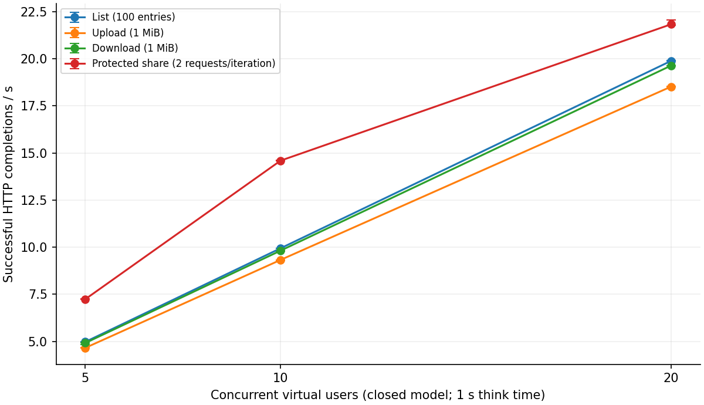
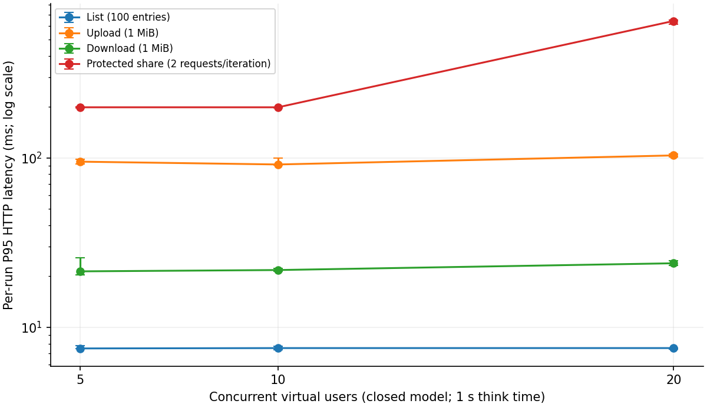

# 实验一：六容器网盘的性能与资源开销

测试日期：2026 年 11 月 16 日。P1—P4 的 36 轮基础实验已完成，20 MiB 扩展完成了两轮上传，余下四轮保持暂停。

列表和 1 MiB 上传在三档并发下全部成功。分享访问的延迟增幅最明显：并发从 10 增至 20 时，HTTP P95 从 198.81 ms 升至 643.15 ms，分享服务的 CPU 消耗也接近四核量级。基础实验共记录 52,371 次正式请求，其中下载和分享出现 14 次依赖不可用错误。

## 1. 环境与数据来源

| 项目 | 实际配置 |
| --- | --- |
| 主机 | Windows 11；Intel Core Ultra 9 285H；16 个逻辑处理器；约 31.50 GiB 内存 |
| 容器环境 | Docker Desktop / WSL2；Docker 29.9.2；Compose 5.6.1 |
| Docker 资源 | 4 CPU；4,107,522,048 字节内存，约 3.83 GiB |
| 应用 | frontend、auth-service、file-service、share-service、MySQL、MinIO 六容器 |
| 存储 | MySQL、MinIO 使用 WSL2 中的 Docker 命名卷；初始化脚本从 Windows D 盘挂载 |
| 负载工具 | Windows 主机 Python 3.13.5、requests 2.32.4；独立进程采集容器资源 |
| 入口 | `http://127.0.0.1:8080`，请求经过前端 Nginx |

数据来自两个不重叠的正式批次，续跑前核对了应用镜像、Compose、Docker 资源预算以及负载和采集脚本。

| 批次 | 测量范围 | 冻结提交 | 原始清单 |
| --- | --- | --- | --- |
| 20261116-e1-formal-ipv4 | P1、P2、P3，共 27 轮 | `5fb0392` | [matrix.json](../../experiments/E1/20261116-e1-formal-ipv4-summary/matrix.json) |
| 20261116-e1-continuation | P4 九轮，P5U 两轮 | `5186da2` | [matrix.json](../../experiments/E1/20261116-e1-continuation-summary/matrix.json) |

镜像 ID、运行版本、硬件和脚本哈希分别保存在[首批环境快照](../../experiments/E1/20261116-e1-formal-ipv4-summary/environment.json)和[续跑环境快照](../../experiments/E1/20261116-e1-continuation-summary/environment.json)。此前的 pilot、被中断的 localhost 批次和未进入测量的准备目录均保留在原位置，本报告使用上述两个批次的已完成轮次。

## 2. 测量方法

P1 为目录列表，P2 为 1 MiB 上传，P3 为 1 MiB 个人下载。P4 是受保护分享访问，一次业务迭代依次完成匿名提取码验证和匿名下载，正常情况下包含两次 HTTP 请求。

每个基础场景使用 5、10、20 个虚拟用户，各重复三次，并轮换并发档位的执行顺序。每轮预热 30 秒，正式测量 120 秒，冷却至少 30 秒。负载采用闭环模型，每个用户完成一次业务迭代后等待 1 秒。每个用户有独立账号和数据，列表目录固定为 99 个目录项和一个种子文件。登录、源文件校验和上传清理均在正式窗口之外进行，每轮重新登录并检查凭证有效期。

HTTP 延迟从发送预处理后的请求开始，到完整响应体接收结束。multipart 编码和响应校验在该计时之外；业务迭代耗时包括请求准备与业务步骤，不含迭代后的 1 秒等待。正式窗口内发起的失败、超时和晚完成请求均保留在成功率统计中，吞吐量只计窗口内完成的成功请求。

表中吞吐量和延迟均为三轮指标的中位数，P95 方括号列出三轮最小—最大值。每轮独立计算分位数，完整范围和原值见[重复汇总](../../experiments/E1/20261116-e1-combined-summary/aggregate.csv)与[逐轮表](../../experiments/E1/20261116-e1-combined-summary/per-round.csv)。

## 3. 基础实验结果

| 场景 | VU | 三轮请求数 | 失败数 | 成功 HTTP 请求/s | HTTP P95 ms [范围] | HTTP P99 ms |
| --- | ---: | ---: | ---: | ---: | --- | ---: |
| P1 列表 | 5 | 1,790 | 0 | 4.975 | 7.49 [7.47—7.81] | 8.21 |
| P1 列表 | 10 | 3,578 | 0 | 9.942 | 7.53 [7.36—7.70] | 8.15 |
| P1 列表 | 20 | 7,158 | 0 | 19.883 | 7.53 [7.41—7.56] | 8.33 |
| P2 上传 | 5 | 1,678 | 0 | 4.658 | 94.94 [91.67—98.42] | 219.74 |
| P2 上传 | 10 | 3,354 | 0 | 9.325 | 91.38 [90.46—99.48] | 321.58 |
| P2 上传 | 20 | 6,671 | 0 | 18.517 | 103.35 [100.90—105.64] | 378.12 |
| P3 下载 | 5 | 1,764 | 3 | 4.917 | 21.37 [20.38—25.77] | 22.63 |
| P3 下载 | 10 | 3,533 | 2 | 9.817 | 21.75 [21.30—22.19] | 23.68 |
| P3 下载 | 20 | 7,069 | 3 | 19.633 | 23.85 [23.23—24.65] | 27.80 |
| P4 分享 | 5 | 2,610 | 3 | 7.242 | 198.83 [196.66—199.84] | 204.14 |
| P4 分享 | 10 | 5,263 | 2 | 14.592 | 198.81 [196.52—199.13] | 207.80 |
| P4 分享 | 20 | 7,903 | 1 | 21.825 | 643.15 [616.88—650.00] | 728.14 |

P1 的 P95 始终约为 7.5 ms，吞吐量随并发增加。P2 在 20 VU 下达到约 18.52 MiB/s，P95 为 103.35 ms，P99 从 5 VU 时的 219.74 ms 增至 378.12 ms。P3 的 P95 在 21—24 ms 之间，12,366 次请求中出现 8 次失败，成功率为 99.9353%。

P4 在 5、10 VU 下的 P95 均约为 199 ms，20 VU 时升至约 643 ms。其业务吞吐量与 CPU 消耗如下。CPU 和内存先按轮求均值，再取三轮中位数；内存为工作集口径。

| P4 并发 | 成功业务迭代/s | share-service CPU 均值 % | share-service 内存均值 MiB |
| --- | ---: | ---: | ---: |
| 5 VU | 3.617 | 140.28 | 235.97 |
| 10 VU | 7.292 | 270.57 | 232.96 |
| 20 VU | 10.892 | 412.80 | 236.11 |

从 10 到 20 VU，分享业务吞吐增加约 49%，P95 则增加约 224%。资源曲线把主要 CPU 消耗定位到了分享服务。源码中的提取码校验使用 BCrypt，每次验证和下载都会检查；这为后续分析提供了具体排查方向，当前没有通过 CPU 剖析进一步分离校验、调度和其他处理的开销。





## 4. 错误、完整性与资源采样

基础实验中的 14 次失败均为 HTTP 503、`DEPENDENCY_UNAVAILABLE`，其中 P3 八次、P4 六次，没有请求超时。P4 的 15,776 次请求成功率为 99.9620%。失败轮次和错误分类保留在各自的 `errors.csv` 与汇总指标中。现有日志没有给出足以定位这些短暂依赖错误的底层异常，后续论文应将错误现象与原因判断分开表述。

已完成 38 轮共有 860 次轮前、轮后种子文件 SHA-256 校验，全部一致；P4 还对每次成功下载校验正文哈希。P2 含预热共清理 14,635 个上传文件，P5 两轮共清理 1,029 个，均复核对象不存在和配额恢复。删除过程中与后台清理竞争产生的非零命令退出码保留在记录中，清理结果由对象枚举与配额检查确认。

资源采集目标间隔为 1 秒，38 轮预期 27,360 条容器样本，实际 27,346 条。逐轮逐容器估计缺失 15 条，另有一条边界多采样；已有样本的 CPU 字段完整。CPU 采用 Docker Engine 计数器差分口径，100% 约对应一个逻辑核；接近满载时出现略高于名义四核 400% 的估计值，报告保留原值。内存按 usage 减 inactive_file 统计。[资源表](../../experiments/E1/20261116-e1-combined-summary/resource-summary.csv)保留各容器均值、峰值和缺样信息。

## 5. 20 MiB 扩展与暂停记录

P5U 已完成的两轮均为 5 VU，参数仍为 30 秒预热、120 秒测量、至少 30 秒冷却，每 VU 含预热最多上传 150 次。下面按轮列出结果。

| 轮次 | 正式请求数 | 失败数 | 成功请求/s | 正文字节吞吐 MiB/s | HTTP P95 ms | HTTP P99 ms |
| --- | ---: | ---: | ---: | ---: | ---: | ---: |
| 1 | 424 | 0 | 3.525 | 70.500 | 702.67 | 846.39 |
| 2 | 400 | 0 | 3.317 | 66.333 | 830.05 | 1,144.30 |

第三轮上传在预热前触发磁盘余量检查，随后按用户要求暂停。测试对象已清理，WSL 数据盘内的空闲空间已释放；宿主的 Docker VHDX 仍占约 44.54 GiB，C 盘剩余约 17.8 GiB。[维护记录](../../experiments/E1/20261116-e1-continuation-summary/storage-maintenance.json)保存了这一过程。空间检查修正提交 `c15f964` 尚未用于正式测量。

扩展场景还剩一轮上传和三轮下载。两轮上传可作为已测条件的单轮结果引用，完整的大文件对照结论待剩余轮次完成后整理。

## 6. 论文使用范围与复算

这组数据描述固定机器和资源预算下的六容器应用。闭环模型中的 1 秒思考时间限制了请求到达率，吞吐量反映设定负载下的表现。容器与非容器部署的性能差异需要另外建立同业务、同资源条件的对照实验。

原始请求、资源与错误均可复算。先分别重算两个源批次，再生成新的派生目录，避免覆盖已有结果：

```powershell
python scripts/performance/analyze.py 20261116-e1-formal-ipv4
python scripts/performance/analyze.py 20261116-e1-continuation
python scripts/performance/combine.py --sources 20261116-e1-formal-ipv4 20261116-e1-continuation --output e1-recomputed
```

[全部 38 轮指标](../../experiments/E1/20261116-e1-combined-summary/metrics.json)与[批次对应关系](../../experiments/E1/20261116-e1-combined-summary/matrix.json)用于追溯报告中的每个数值。
