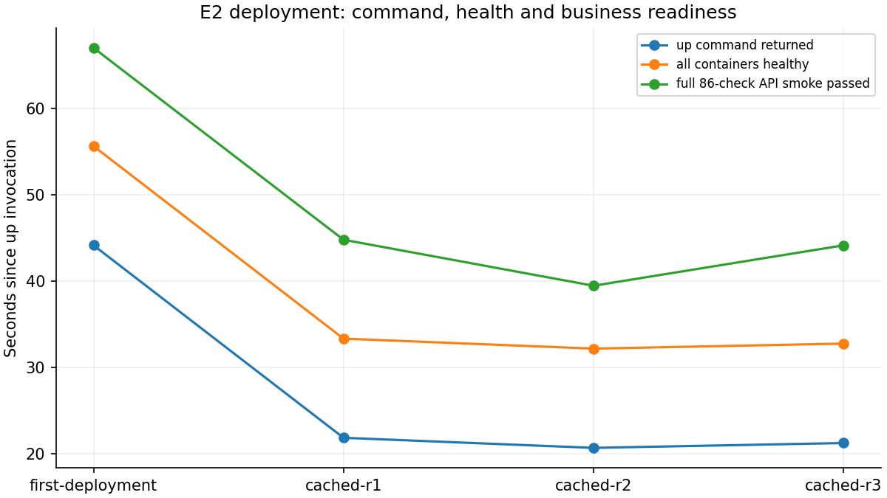
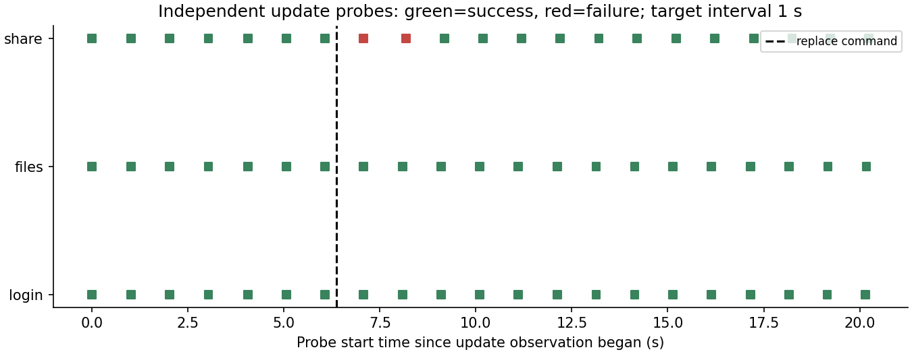
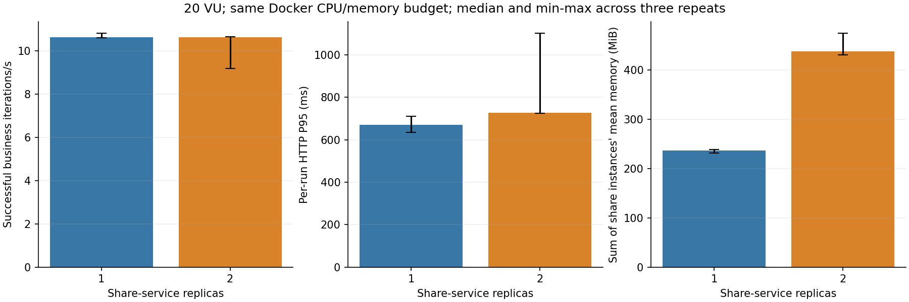

# 实验二：Compose 编排与独立部署

2026 年 11 月 16 日 17:18—17:43，在独立项目 `cloud-drive-e2-20261116` 中完成首次部署、三次已有镜像启动、分享服务独立更新和双副本扩展。整套环境可以通过 Compose 启动，分享服务可以单独替换，两个分享实例能够共享状态并接收入口请求。在相同 Docker 总资源预算下，双副本的业务吞吐基本持平，分享服务的内存开销增加。

## 1. 环境与计时方法

实验使用 Windows 11、Docker Desktop/WSL2，Docker 29.9.2、Compose 5.6.1。主机为 Intel Core Ultra 9 285H，16 个逻辑处理器、约 31.50 GiB 内存；Docker 总预算为 4 CPU、4,107,522,048 字节内存。负载和观测工具运行在 Windows 主机，业务从 `http://127.0.0.1:8080` 进入 Nginx。

源码冻结提交为 `3321e73`。E2 使用独立镜像标签、网络及 MySQL/MinIO 新卷，凭证单独生成。E1 容器在实验期间停止，原卷和镜像保留，结束后恢复原容器并校验原文件。[环境快照](../../experiments/E2/20261116-e2-formal/environment.json)保存了版本、预算和脚本哈希。

首次部署使用已有基础镜像和 BuildKit 缓存，同时从源码执行构建并初始化空卷。镜像与依赖的实际缓存命中由[构建启动日志](../../experiments/E2/20261116-e2-formal/first-deployment/up.log)记录。已有镜像场景固定镜像和数据卷，执行保留卷的 `down`、`up -d`，重复三次。

每轮分别记录启动命令返回、全部容器健康、完整业务冒烟通过三个时刻。业务终点为 FR-01—FR-12 共 86 项 API 检查通过，包含注册、登录、文件操作、分享与权限校验；清理和关闭耗时单列。状态观察目标间隔为 0.5 秒，就绪轮询为 1 秒，表格小数用于保留记录精度。

## 2. 部署结果

| 轮次 | up 命令返回/s | 全部容器健康/s | 完整业务冒烟通过/s | API 检查 |
| --- | ---: | ---: | ---: | ---: |
| 源码构建与空卷首次部署 | 44.17 | 55.66 | 67.04 | 86/86 |
| 已有镜像启动 1 | 21.87 | 33.36 | 44.81 | 86/86 |
| 已有镜像启动 2 | 20.70 | 32.20 | 39.48 | 86/86 |
| 已有镜像启动 3 | 21.26 | 32.78 | 44.17 | 86/86 |

已有镜像启动到业务可用的三次中位数为 44.17 秒，范围为 39.48—44.81 秒。MySQL 的三个业务库和 MinIO 私有桶在首次部署中自动准备；三次重建均保留原卷，固定样本和原分享继续可用。

启动命令返回后，前端健康检查和业务验证仍需要时间。例如首次部署的 up 在 44.17 秒返回，业务验证在 67.04 秒完成。用 up 的返回时间代表系统可用，会漏掉这段等待。



精确计时见[部署汇总表](../../experiments/E2/20261116-e2-formal/deployment-summary.csv)，容器状态变化、网络与卷清单保存在各部署轮次目录。

## 3. 分享服务独立更新

更新把分享服务从 e2-v1 改为 e2-v2，通过构建参数写入镜像版本标签，再只构建和替换 share-service。检查了新镜像 ID、版本标签和业务响应头，frontend、auth-service、file-service、mysql、minio 的容器 ID、启动时间与镜像 ID 均保持不变。Nginx 在配置校验后重载，原分享下载及文件 SHA-256 校验通过。

| 项目 | 结果 |
| --- | --- |
| 分享镜像独立构建 | 1.37 秒 |
| 替换命令返回 | 1.11 秒 |
| 从替换开始到健康观测 | 约 7.42 秒 |
| Nginx 校验与重载命令 | 0.77 秒 |
| 登录探测 | 21/21 成功 |
| 文件列表探测 | 21/21 成功 |
| 原有效分享探测 | 19/21 成功，两次 HTTP 502 |
| 更新后完整 API 冒烟 | 86/86 通过 |

分享采用单副本替换，更新期间出现短暂不可用。两次失败样本跨度约 1.11 秒，两侧相邻成功探测的响应间隔约 3.44 秒。探测目标间隔为 1 秒，原始时刻和在途请求耗时见 [probes.csv](../../experiments/E2/20261116-e2-formal/independent-update/probes.csv)，这些离散样本用于描述观察到的窗口。



[更新记录](../../experiments/E2/20261116-e2-formal/independent-update/update.json)保存了构建、替换、就绪和版本核验结果。实验展示了单服务独立更新及其影响范围，观测到的分享失败按原样保留。

## 4. 双副本分发与共享状态

扩容到两个分享实例后重载 Nginx，连续发出 100 次真实入口请求，全部成功。响应头中的实例标识如下。

| X-Instance-Id | 收到的请求数 |
| --- | ---: |
| 775e558bbe07 | 58 |
| 155e0dc4c2de | 42 |

随后定向在实例 A 创建受保护分享，在 B 验证、下载并取消，再由 A 读取取消结果。下载内容与 1 MiB 原文件一致，取消后 A 返回 `410 SHARE_CANCELLED`。这些操作使用已有 MinIO 容器中的 curl 作为一次性内部客户端，凭证通过标准输入传递；网关分发由前面的 100 次入口请求单独验证。

错误提取码按实例分别累计。A 的前五次错误返回 403，第六次返回 429；B 此后仍按自己的计数处理，同样在第六次返回 429。正确提取码继续通过。结果对应当前每实例限流实现。原始证据见[请求分发表](../../experiments/E2/20261116-e2-formal/two-instance-validation/distribution.csv)、[跨实例状态记录](../../experiments/E2/20261116-e2-formal/two-instance-validation/cross-instance.json)和[限流记录](../../experiments/E2/20261116-e2-formal/two-instance-validation/per-instance-limits.csv)。

## 5. 相同资源预算下的副本性能

对照采用 E1 中负载较明显的 20 VU 分享场景：每个用户使用独立账号和目录，匿名验证提取码后下载 1 MiB 文件，每次业务迭代后等待 1 秒。每轮预热 30 秒、测量 120 秒、冷却至少 30 秒。一副本和双副本各三轮，顺序为 1→2、2→1、1→2，保留已有实例，新建实例使用同样的预热时长。Docker 总 CPU/内存预算保持不变。

| 指标 | 一副本，三轮中位数 [范围] | 双副本，三轮中位数 [范围] |
| --- | --- | --- |
| 成功 HTTP 请求/s | 21.358 [21.267—21.725] | 21.300 [18.442—21.375] |
| 成功业务迭代/s | 10.650 [10.617—10.825] | 10.633 [9.192—10.667] |
| HTTP P95/ms | 671.39 [635.26—711.52] | 726.46 [724.12—1,102.25] |
| HTTP P99/ms | 754.73 [751.92—786.77] | 886.11 [843.16—1,451.44] |
| 业务迭代 P95/ms | 1,245.27 [1,194.59—1,306.86] | 1,282.34 [1,270.14—2,048.03] |
| 分享实例 CPU 均值之和/% | 411.18 [407.15—412.25] | 413.84 [412.20—415.32] |
| 分享实例工作集内存均值之和/MiB | 237.30 [231.47—238.47] | 437.78 [430.70—475.04] |
| 三轮正式请求数 | 7,753 | 7,363 |
| 失败数 | 1 | 1 |

双副本的业务吞吐中位数比单副本低约 0.16%，HTTP P95 高约 8.20%，分享实例内存均值之和增加约 84.49%。本次扩容实现了请求分发，性能数据则表现为吞吐基本持平、内存消耗增加。双副本第一轮的 P95 为 1,102.25 ms，后两轮约为 724—726 ms，重复间波动需要与中位数一起引用。

两种配置的分享服务 CPU 消耗都接近四核量级。下游日志中，文件元数据操作 P95 为 9—13 ms，内容传输 P95 为 12—20 ms，分享请求自身的服务端 P95 为 568—980 ms。主要耗时集中在分享服务一侧，与固定 CPU 预算下的资源竞争相符。新实例的 JVM 暖机状态随执行顺序变化，现有测量没有单独分离这部分影响。



六轮共有 15,116 次正式 HTTP 请求，两次失败均为 `503 DEPENDENCY_UNAVAILABLE`，没有请求超时。240 次轮前、轮后种子文件 SHA-256 校验全部一致。资源预期采样 4,680 条，实际 4,676 条，已有样本的 CPU 字段完整。CPU 按 Docker Engine 计数器差分估计，100% 约对应一个逻辑核；满载附近的估计值略高于名义四核 400%，原值保留。各实例均值可以相加，分别出现的内存峰值不作同时刻总峰值解释。

精确结果见[副本汇总表](../../experiments/E2/20261116-e2-formal/replica-summary.csv)、[逐轮对照表](../../experiments/E2/20261116-e2-formal/replica-per-round.csv)和[资源表](../../experiments/E2/20261116-e2-formal/resource-summary.csv)。HTTP 与业务迭代的吞吐口径沿用 E1，固定思考时间与该执行顺序共同限定了结果的适用条件。

## 6. 验证、收尾与复算

六次完整 API 冒烟各 86 项，合计 516 项检查通过。项目保护、上下文选择、凭证脱敏和性能统计等九个 Python 单元测试通过；PowerShell 脚本语法、Compose 配置和实际构建均已检查。本轮没有修改 Java 业务、前端页面、SQL、JWT 或内部接口，未单独重跑宿主 Maven、前端 lint 或旧 Java 规范检查器。源码构建日志保留了缓存命中，不能把缓存构建当作重新执行所有 Java 测试。

双副本测试结束后已恢复一副本、重载 Nginx，并通过最后一次 86 项检查。E2 容器随后正常停止，专用数据卷保留；E1 原六个容器恢复健康，ID 和镜像与实验前一致，原有 20 份 1 MiB、5 份 20 MiB 文件在实验前后共 50 次校验全部一致。E1 的 P5 保持暂停。C 盘结束时约有 17.79 GiB 可用。

数据准备复用了 E1 工具，为 20 个负载用户建立固定目录和种子文件，其中额外五份 20 MiB 种子未参与 E2 正式传输。E2 的部署时间对应本机已有缓存条件，副本对照对应单机手动扩容和固定总预算；报告中的性能变化按三次重复的中位数与范围描述。

公开日志经过凭证脱敏和行末空白规范化，请求、计时和资源 CSV 保留采集值。下列命令从原始请求、迭代和资源 CSV 重算指标并生成图表：

```powershell
python scripts/deployment/e2_analyze.py 20261116-e2-formal
```

[执行清单](../../experiments/E2/20261116-e2-formal/manifest.json)记录完成状态，[脚本与执行说明](../../scripts/deployment/README.md)提供复现入口。原始记录中的两次 502 更新失败和两次 503 性能请求失败分别保留。
