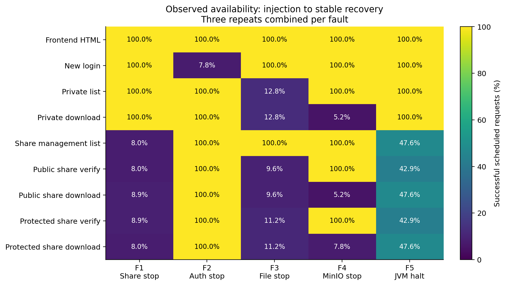
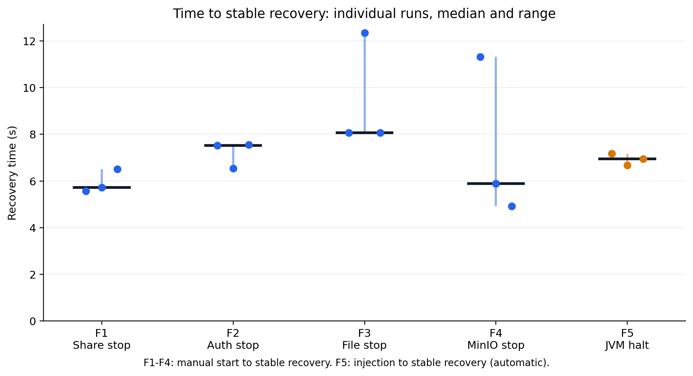

# E3 服务故障影响与恢复实测报告

负责人：刘骐语。数据批次：`20261117-154613-c1`。

## 恢复时间

人工停服使用启动命令时刻 t3 为起点；JVM 异常退出使用注入时刻 t0 为起点。终点为每条探针连续三次成功的第一次发出时刻，再取全部业务恢复的最晚值。

| 故障 | 第一次/s | 第二次/s | 第三次/s | 中位数/s | 最小—最大/s |
|---|---:|---:|---:|---:|---:|
| F1 | 5.568 | 5.725 | 6.512 | 5.725 | 5.568—6.512 |
| F2 | 7.527 | 6.545 | 7.557 | 7.527 | 6.545—7.557 |
| F3 | 8.064 | 12.344 | 8.067 | 8.067 | 8.064—12.344 |
| F4 | 11.327 | 5.887 | 4.923 | 5.887 | 4.923—11.327 |
| F5 | 7.178 | 6.672 | 6.944 | 6.944 | 6.672—7.178 |

本批续自 `20261117-154613`，继承已完成轮次：F1-r1, F1-r2, F1-r3, F2-r1, F2-r2, F2-r3, F3-r1, F3-r2, F3-r3。原批因对象不存在的 CLI 返回格式被校验器误判而停止；失败轮次不纳入。续跑前核对六服务镜像 ID、探针源码哈希和原样本，继承文件逐项校验 SHA-256。原记录和续跑来源清单保留。

统计修订：impact.csv 的业务失败窗口采用 t5−首次失败回包时间，与 t1 定义一致。原值、逐行差异和修订前证据索引保存在 analysis-revisions/20261117-failure-window-v2/；恢复时间、成功率及图表数值不变，原始探针记录未改动。

## 故障影响

下表汇总三轮中从 t0 到共同稳定恢复 t5 的探测；调度时间决定窗口归属。原始业务码、错误类别和调度偏差见 impact.csv/probe.csv。

| 故障 | 业务 | 窗口成功/计划请求 | 成功率 |
|---|---|---:|---:|
| F1 | files | 112/112 | 100.00% |
| F1 | frontend | 112/112 | 100.00% |
| F1 | login | 112/112 | 100.00% |
| F1 | personal_download | 112/112 | 100.00% |
| F1 | share_0_download | 10/112 | 8.93% |
| F1 | share_0_verify | 9/112 | 8.04% |
| F1 | share_1_download | 9/112 | 8.04% |
| F1 | share_1_verify | 10/112 | 8.93% |
| F1 | share_list | 9/112 | 8.04% |
| F2 | files | 116/116 | 100.00% |
| F2 | frontend | 116/116 | 100.00% |
| F2 | login | 9/116 | 7.76% |
| F2 | personal_download | 116/116 | 100.00% |
| F2 | share_0_download | 116/116 | 100.00% |
| F2 | share_0_verify | 116/116 | 100.00% |
| F2 | share_1_download | 116/116 | 100.00% |
| F2 | share_1_verify | 116/116 | 100.00% |
| F2 | share_list | 116/116 | 100.00% |
| F3 | files | 16/125 | 12.80% |
| F3 | frontend | 125/125 | 100.00% |
| F3 | login | 125/125 | 100.00% |
| F3 | personal_download | 16/125 | 12.80% |
| F3 | share_0_download | 12/125 | 9.60% |
| F3 | share_0_verify | 12/125 | 9.60% |
| F3 | share_1_download | 14/125 | 11.20% |
| F3 | share_1_verify | 14/125 | 11.20% |
| F3 | share_list | 125/125 | 100.00% |
| F4 | files | 116/116 | 100.00% |
| F4 | frontend | 116/116 | 100.00% |
| F4 | login | 116/116 | 100.00% |
| F4 | personal_download | 6/116 | 5.17% |
| F4 | share_0_download | 6/116 | 5.17% |
| F4 | share_0_verify | 116/116 | 100.00% |
| F4 | share_1_download | 9/116 | 7.76% |
| F4 | share_1_verify | 116/116 | 100.00% |
| F4 | share_list | 116/116 | 100.00% |
| F5 | files | 21/21 | 100.00% |
| F5 | frontend | 21/21 | 100.00% |
| F5 | login | 21/21 | 100.00% |
| F5 | personal_download | 21/21 | 100.00% |
| F5 | share_0_download | 10/21 | 47.62% |
| F5 | share_0_verify | 9/21 | 42.86% |
| F5 | share_1_download | 10/21 | 47.62% |
| F5 | share_1_verify | 9/21 | 42.86% |
| F5 | share_list | 10/21 | 47.62% |

F1 分享服务停止；F2 认证服务停止；F3 文件服务停止；F4 MinIO 停止；F5 分享 JVM halt(17)；F6 为可选 MySQL 停止。

## 方法与证据

每轮基线 30 秒，停服确认后维持 30 秒，F1—F5 各三轮。私有文件探针整轮使用注入前的同一 JWT；登录探针不会补发其凭证。普通请求 5 秒、下载 15 秒绝对期限，由独立子进程执行，超时终止。1 Hz 探测给出约一秒的采样分辨率，实际调度偏差已逐请求记录。

F5 的 Docker die 事件必须包含 exitCode=17，并验证同一容器 RestartCount 增加。运行状态、健康状态、业务稳定恢复分开记录；F5 启用/关闭故障开关所需重建和 Nginx reload 在计时窗口之外。所有恢复后样本经过个人及两种分享下载校验。

MinIO 故障轮次额外验证失败上传不增加容量，删除产生持久待清理任务；恢复后等待任务自然重试并确认对象消失。没有手工删除队列或修改重试时间。

原始数据：[批次目录](../../experiments/E3/20261117-154613-c1/)。每轮 events.json、states.jsonl、docker-events.jsonl、execution.jsonl、probe.csv、容器快照、服务日志和 verification/ 为对应证据。实验结束关闭故障钩子并保存 404 验证。

单机服务级实验不能说明宿主机或磁盘故障下的高可用性。没有观察到失败的探针按实际采样报告，不能推出零停机。

## 环境与采样精度

Docker Engine 29.9.3，Docker Compose version v5.7.0，Docker 可见 22 个逻辑 CPU、15.43 GiB 内存。续跑环境记录提交 `8ca3520`，逐轮镜像 ID 和源码文件哈希见环境快照。

计划频率为 1 Hz，实际请求发出相对计划的最大滞后为 3.503 秒。t1 使用故障后实际发出请求的失败回包时刻，另列首次失败发出时刻；t5 使用连续三次成功 tick 中首个请求的实际发出时刻。表格保留三位小数用于复算，不表示毫秒级测量精度。

## 论文图表

热图的分母是各故障从注入至稳定恢复窗口内的计划请求数。人工停服包含 30 秒保持窗口，自动退出没有这一人为停服窗口；这些百分比描述本轮故障过程。

点表示单次结果，黑线表示中位数，竖线表示最小—最大范围。F1—F4 从人工启动命令计时，F5 从注入命令计时。

三次重复的实际发出时间线（每条竖线为一次探针，绿为成功、红为失败）：[F1](../../experiments/E3/20261117-154613-c1/figures/timeline-F1.pdf)、[F2](../../experiments/E3/20261117-154613-c1/figures/timeline-F2.pdf)、[F3](../../experiments/E3/20261117-154613-c1/figures/timeline-F3.pdf)、[F4](../../experiments/E3/20261117-154613-c1/figures/timeline-F4.pdf)、[F5](../../experiments/E3/20261117-154613-c1/figures/timeline-F5.pdf)。

矢量版：[影响热图 PDF](../../experiments/E3/20261117-154613-c1/figures/availability.pdf)、[恢复时间 PDF](../../experiments/E3/20261117-154613-c1/figures/recovery-time.pdf)。生成器、输入文件和图表哈希见 figures/provenance.json。
