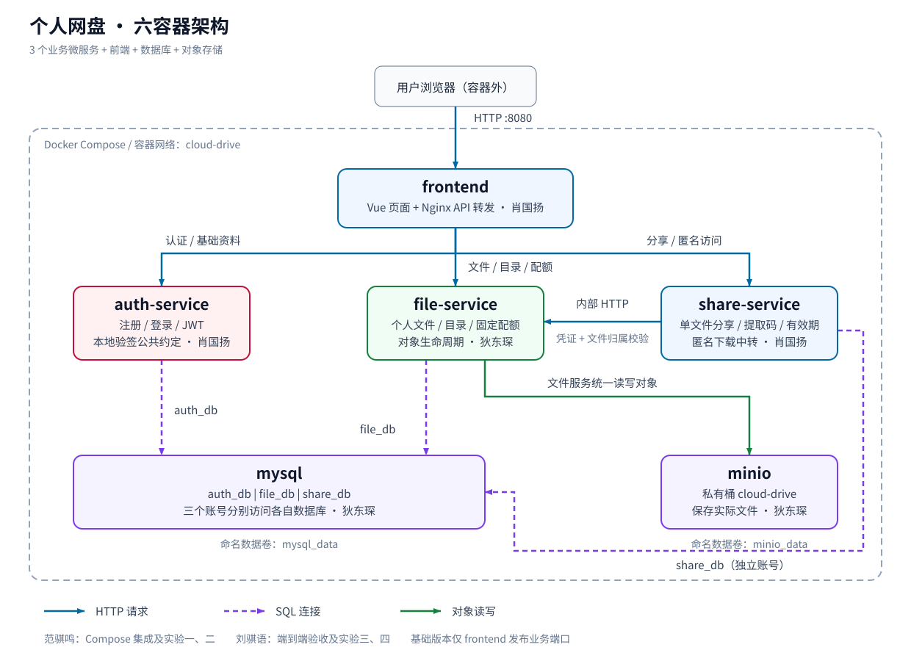

# 基于 Docker Compose 的个人网盘系统课程设计



课程：《云计算与虚拟化技术》  
方案版本：V3.3，2026 年 11 月 15 日
项目成员：肖国扬、狄东琛、范骐鸣、刘骐语\
原项目：https://github.com/Fqmmm/cloud-drive

这份计划说明三件事：网盘要做成什么样，四个人怎么分工，系统完成后怎么做实验。

想先了解用户能做什么，读[网盘功能需求](functional-requirements.md)；想了解某个容器具体怎么开发，读 `docs/phase1/`；想按步骤做实验，读 `docs/phase2/`。本文把这些内容串起来，供大家安排工作。

## 一、建设目标与功能范围

我们用去年软件工程课的网盘继续做课程项目。保留个人文件和分享功能，把原来放在一个 Spring Boot 程序里的后端，拆成认证、文件、分享三个程序，并为了简化处理，删除团队功能。三个程序可以分别运行、分别更新，这里称为三个业务**微服务**。

**整个系统一共六个容器：一个提供网页（前端），三个处理业务（后端微服务），一个运行 MySQL，一个运行 MinIO。**仓库根目录的 `compose.yaml` 写明它们怎么启动、互相怎么连接、数据放在哪里。执行启动命令后，Compose 按配置把整套系统运行起来。

最终演示要走通这条流程：用户注册并登录，创建目录，上传和下载文件，再创建一个分享链接；接收者不用登录也能按规则下载，所有者可以取消分享。用户记录、分享记录和文件内容要保存在独立的数据卷中，重建容器后继续使用。

文档里的“六个服务”指 Compose 管理的六个运行单元。其中只有 auth-service、file-service、share-service 是业务微服务。frontend 是网页和 Nginx，mysql 和 minio 负责存数据。

### 1.1 首版交付范围

先完成下面这些功能，让它们能连续使用。

| 类别 | 要做什么 | 规则 |
|---|---|---|
| 用户 | 注册、登录、查看基础资料、退出 | 只支持个人账户；退出时清除当前浏览器的登录凭证 |
| 文件和目录 | 看文件列表，创建和重命名目录，上传、下载、重命名和删除文件 | 只能操作自己的内容；目录只能空删；请求用文件 ID 指定目标 |
| 容量 | 显示总容量和已用容量，空间不足时拒绝上传 | 默认每人 10 GiB，单文件最多 100 MiB，部署时可以调整 |
| 分享 | 为一个文件创建链接，设置提取码和有效期，查看及取消分享 | 有效期可选 1、7、30 天或永久；接收者不用登录 |
| 网页 | 登录注册、个人文件、我的分享、分享访问 | 浏览器始终访问同一个网站地址，由前端容器转发后台请求 |
| 部署 | 一次启动六个容器，自动准备数据库和存储，能查状态和日志 | 六个容器都能运行，实际业务也要能用 |

为了简化微服务的拆分，首版目标不考虑：团队、邀请、Flowable、自定义 RBAC 权限、会员、动态配额、私密空间、Redis、SSE 下载进度、目录分享和访问统计。去重、回收站、移动复制、搜索和全量孤儿对象扫描放在扩展项里，基础功能验收通过后再决定是否做。“孤儿对象”指存储中有文件内容，但数据库里已经没有对应记录的情况。

**首版删除就是永久删除（即不考虑回收站）。**网页确认后，文件立即从列表消失，旧分享也不能再发起下载；后台随后清理实际存储的内容，清理失败可以重试。网页上要写清“永久删除”，不提供回收站恢复入口。

在课程分支中修改项目，原来的完整版本通过 Git 保留。移除功能时，页面入口、后台接口和启动依赖一起处理。例如，去掉 Redis 后，还要检查防重复提交等公共组件是否仍通过 Redisson 连接 Redis，避免网页删干净了，后台却因为缺少旧组件而启动失败。

## 二、六容器方案

六个容器各做一部分工作，职责如下。

| 容器 | 负责人 | 负责什么 | 数据或协作对象 | 详细需求 |
|---|---|---|---|---|
| frontend | 肖国扬 | 提供用户看到的网页，把登录、文件、分享请求转给对应后台 | 三个业务服务；Vue 页面和 Nginx 放在同一个容器 | [前端](phase1/frontend.md) |
| auth-service | 肖国扬 | 处理注册登录，确认用户身份，提供基础用户资料 | auth_db | [认证](phase1/auth-service.md) |
| share-service | 肖国扬 | 管理链接、提取码和有效期，检查接收者能否下载，再转发文件 | share_db；通过 HTTP 找 file-service 获取文件信息和内容 | [分享](phase1/share-service.md) |
| file-service | 狄东琛 | 管理个人文件、目录和容量，检查归属，处理实际文件的保存与清理 | file_db 和 MinIO | [文件](phase1/file-service.md) |
| mysql | 狄东琛 | 保存账户、文件名称与归属、容量、分享链接等记录 | 使用 mysql_data 数据卷 | [数据库](phase1/mysql.md) |
| minio | 狄东琛 | 保存 PDF、照片、压缩包等文件的实际内容 | 使用 minio_data 数据卷 | [对象存储](phase1/minio.md) |

例如，用户上传一份 PDF：frontend 把请求交给 file-service；file-service 检查用户身份、容量和文件大小，把 PDF 内容存进 MinIO，再把文件名、大小、归属和存放位置等记录存进 MySQL。创建分享时，share-service 再参与处理。登录后的普通文件请求可以直接验证登录凭证，不必每次都找 auth-service。

### 2.1 通信、端口和入口

用户在浏览器打开 `http://localhost:8080`。默认只把 frontend 的端口开放给宿主机：`8080:80` 表示电脑上的 8080 端口连接前端容器里的 80 端口。

三个 Java 服务各自在自己的容器里使用 8080 端口，不会互相冲突。容器内部通过服务名找对方，例如 `file-service:8080`。MySQL 使用 3306，MinIO 的文件接口使用 9000。需要调试时用单独的覆盖配置临时开放端口；MinIO 管理页面可绑定到 `127.0.0.1:9001`，供本机查看。

frontend 中的 Nginx 负责按请求路径分发。API 路径保持完整，不去掉 `/api/v1` 前缀。前端分享页面的路径与下面的 `/api/v1/s/` 后台接口分开。

| 请求路径 | 交给谁处理 |
|---|---|
| `/api/v1/auth/`、`/api/v1/users/` | auth-service:8080 |
| `/api/v1/files`、`/api/v1/files/`、`/api/v1/directories`、`/api/v1/directories/`、`/api/v1/quota` | file-service:8080 |
| `/api/v1/shares`、`/api/v1/shares/`、`/api/v1/s/` | share-service:8080 |
| `/internal/`、业务服务 `/health/` | 不向浏览器转发，供容器内部调用或检查状态 |

前端接口统一从 `/api/v1` 开始。Axios 的 baseURL 使用空串或同一个网站的根路径，避免两处重复添加前缀，拼成 `/api/v1/api/v1`。

普通接口继续返回 `{code, msg, data}`：code 表示处理结果，msg 是提示信息，data 是业务数据。成功码为字符串 `00000`。下载成功时直接返回文件内容。

失败时，HTTP 状态说明错误的大类：401 是登录凭证无效，403 是没有权限或提取码错误，404 是资源不存在或不可见，409 是名称冲突等业务冲突，410 是分享已取消或过期，413 是上传太大，429 是错误提取码尝试受限，503 是依赖服务暂不可用。需要区分“已取消”和“已过期”等具体原因时，使用[分享业务码表](phase1/share-service.md#2-对外-api)。Nginx 返回的错误可能不是 JSON，前端按 HTTP 状态给出通用提示即可，不额外要求统一改写错误页。

JWT 可以理解为登录成功后发给浏览器的一张有期限的通行证。三个业务服务都能验证它的签名和有效期，所以文件、分享服务不用每次回调认证服务。三者使用同一份受控的 JWT 签名密钥。

分享服务调用文件服务的内部接口时，另带 `INTERNAL_API_TOKEN`，用来证明调用来自受信的服务。它与用户 JWT 的密钥分开配置，不交给浏览器。日志中过滤密码、JWT、提取码、数据库密码和内部凭证。

### 2.2 数据与事务归属

MySQL 只运行一个容器，里面分成 `auth_db`、`file_db`、`share_db` 三个数据库，分别给三个业务服务使用。每个服务有自己的数据库账号，只读写自己负责的库。肖国扬、狄东琛 各自维护所属业务的表，狄东琛 汇总首次建库和后续更新所需的脚本。

服务之间可以保存用户 ID、文件 ID 等编号。需要知道另一个服务的数据时，通过接口询问，不直接连接对方的库查表，也不建立跨库外键。

注册时，认证服务只创建用户和账户。用户第一次查询容量或上传文件时，文件服务再创建默认容量记录。同一用户同时发来多个请求，也只建立一份容量记录，由数据库唯一约束保证。

文件记录和容量记录放在同一个库里，便于一起提交。例如上传成功时，“增加一条文件记录”和“增加已用容量”应同时生效；有一步失败就一起回滚。这就是这里使用的本地事务。

创建分享前，分享服务找文件服务确认文件属于当前用户。接收者访问时，再检查文件还在不在。文件删除后，分享记录可以留在历史列表中，但新的访问会提示文件失效。只有文件服务连接 MinIO；浏览器和分享服务都不拿对象存储的账号密码。

### 2.3 部署约定

Dockerfile 是把程序做成镜像的构建说明。镜像准备好后，Docker 才能据此创建容器。分工如下：肖国扬 写 auth-service、share-service 和 frontend 的 Dockerfile；狄东琛 写 file-service 的 Dockerfile，并提供 MySQL、MinIO 配置。范骐鸣 提供构建模板，协助前端镜像和 Nginx 配置，把六个服务整理进 `compose.yaml`，同时准备 `.env.example` 和部署脚本。

Java 镜像分为“编译程序”和“运行程序”两个阶段，运行时只带需要的产物。启动命令采用 exec 形式，让 Java 直接成为容器主进程，方便实验中观察它退出后容器如何重启。镜像固定使用已验证的版本，记录 digest，也就是镜像内容的标识，保证演示和实验使用同一份镜像。

MySQL 和 MinIO 的数据放在各自的命名数据卷中，容器换掉后继续挂载原卷。首次启动先等数据库和 MinIO 可用，再让认证、文件服务准备好，随后启动分享服务和前端。文件服务自动检查并创建自己的私有存储桶；已经存在就直接使用，不再增加一个常驻初始化容器。

健康检查要分清两件事：“进程还活着”和“已经准备好处理业务”。检查命令必须能在实际镜像里执行。Compose 使用 `depends_on` 的 `service_healthy` 等待依赖准备好，再启动下游服务。系统运行后如果依赖中断，应用自己通过有限等待、报错和重连处理。[启动依赖说明](https://docs.docker.com/compose/how-tos/startup-order/)

应用配置 `restart: unless-stopped`。程序异常退出时由 Docker 重启；人为停止后由操作者重新启动。健康检查失败用于观察状态，本身不会因为这项重启配置就自动重启容器。[重启策略说明](https://docs.docker.com/engine/containers/start-containers-automatically/)

### 2.4 工程拆分与构建边界

代码仍放在同一个仓库。三个课程后端采用独立 Maven 工程，各自维护 pom、依赖、启动类、配置和 Dockerfile。2026 年 11 月 15 日确认采用此方式，与已交付的 file-service 保持一致。

```text
backend/
  pom.xml                   # 原单体工程入口，课程服务分别独立构建
  auth-service/             # 独立 pom、启动类、配置、Dockerfile
  file-service/             # 独立 pom、启动类、配置、Dockerfile
  share-service/            # 独立 pom、启动类、配置、Dockerfile
```

通用响应、错误码、JWT 字段及验证规则通过服务文档统一维护，并用互操作检查验证。实现中保持相关逻辑集中，协议变更同步三个服务及调用方。业务处理、数据库查询和数据库配置留在各自服务里，协作通过 HTTP 完成。需要提取公共库时另行明确版本与构建方式。

构建三个 Java 镜像时，沿用 B 的 `backend/` 构建上下文约定，指定目标服务目录的 Dockerfile，只复制并构建该服务。仓库根目录可使用 `mvn -f backend/<服务名>/pom.xml verify` 单独验证各服务；运行镜像只包含该服务的运行产物。前端以 `frontend/` 为构建上下文。

### 2.5 A 开发与 AB 联调的提交节奏

按下列功能顺序推进，每行作为一个或多个可独立审阅的功能提交。每个功能完成相关验证、文档和进度更新后，单独 commit 并 push 到开发分支，再进入下一功能。推送前检查相对远端的待推送提交，确保本批只包含当前功能及必要修复。具体操作见 [工作规范](development-workflow.md)。

| 顺序 | 功能提交范围 | 推送前验证 |
|---|---|---|
| 0 | 工作规范、已确认构建决定及实施计划 | 文档内容、引用和 Git 差异 |
| 1 | auth-service 最小构建、配置、健康接口 | 编译构建及健康接口自测 |
| 2 | 个人账户注册 | 字段校验、散列存储、重复账户及事务 |
| 3 | 登录、JWT 与基础资料 | 正反向认证，真实 JWT 调通 B 的文件接口 |
| 4 | 前端登录注册与课程导航精简 | 类型检查、构建、登录及刷新 |
| 5 | 个人文件列表、目录与容量 | 类型契约、目录归属、页面调用 |
| 6 | 文件上传、下载、重命名及永久删除 | SHA-256、冲突、超限与容量刷新 |
| 7 | share-service 最小构建、配置、健康接口与文件客户端 | 构建、内部凭证、下游错误处理 |
| 8 | 分享创建、本人列表与取消 | 归属校验、快照、有效期和取消幂等 |
| 9 | 匿名分享验证与流式下载 | 提取码、限流、失效与文件完整性 |
| 10 | 前端分享管理与匿名访问 | 复制链接、POST 下载及错误提示 |
| 11 | A 的 Dockerfile、Nginx 与运行交付补齐 | A 镜像构建、路由及内部接口阻断 |
| 12 | AB 联调发现的修复 | 每个问题单独复现、修复、验证和推送 |

服务功能所需的测试、SQL 和接口文档随对应功能提交。Dockerfile 可随服务首次可运行时交付，第 11 步补齐 A 的运行交付。推送失败时保留本次提交，排查并重试成功后再推进下一功能。主分支合并按用户授权执行。此顺序管理 A 开发与 AB 联调，C、D 仍按原分工开展工作。

## 三、人员分工与协作

主分工保持“开发 3 + 3，实验 2 + 2”：肖国扬、狄东琛 各负责三个容器，范骐鸣、刘骐语 各负责两组实验。范骐鸣、刘骐语 从第一阶段就开始准备工具和验收，系统稳定后再正式采数据。

| 成员 | 第一阶段做什么 | 第二阶段做什么 | 最后交什么 |
|---|---|---|---|
| 肖国扬 | 前端页面、认证服务、分享服务；确定公共 JWT 用法，精简旧页面 | / | 页面和服务源码、接口说明、前端/认证/分享设计章节 |
| 狄东琛 | 文件服务、MySQL、MinIO；整理表结构，处理文件与容量记录及存储清理 | /                                                            | 文件与存储源码、建库和更新脚本、配置说明、对应设计章节 |
| 范骐鸣 | / | 把六容器接进 Compose；做性能实验、编排与独立部署实验 | 部署配置、实验脚本、原始数据和两份实验报告 |
| 刘骐语 | /                                                            | 准备测试账号、文件和操作用例，检查整条用户流程；做故障恢复实验、持久化实验 | 验收记录、实验脚本、原始数据和两份实验报告 |

## 四、阶段一：六个容器


阶段一先把下面六个容器做出来并接在一起，让用户能从网页完成登录、上传下载和分享。每个容器分别完成哪些工作、拿什么结果验收，按下表执行。

| 编号 | 负责人 | 容器名称 | 实际做什么 | 要拿出的成果 | 详细需求 |
|---|---|---|---|---|---|
| 1 | 肖国扬 | frontend：前端网页 | 保留登录注册、个人文件和分享页面，去掉旧功能入口；把按钮接到三个后端服务；配置 Nginx 转发并制作前端镜像 | 能在浏览器走完注册、登录、上传下载、创建和访问分享；页面刷新和错误提示正常；交付前端代码、Dockerfile 和 Nginx 配置 | [前端](phase1/frontend.md) |
| 2 | 肖国扬 | auth-service：认证服务 | 处理个人账户注册、登录和基础资料；登录成功后发 JWT，让文件和分享服务也能验证用户身份 | 用户可以注册登录，错误密码和失效凭证会被拒绝；交付认证服务代码、Dockerfile、用户与账户建表脚本、接口说明 | [认证](phase1/auth-service.md) |
| 3 | 肖国扬 | share-service：分享服务 | 创建和管理单文件分享，处理提取码、有效期和取消；向文件服务确认文件状态并获取下载内容 | 未登录接收者能按规则下载；错码、过期、取消和文件删除后不能发起新下载；交付分享服务代码、Dockerfile、分享表脚本和接口说明 | [分享](phase1/share-service.md) |
| 4 | 狄东琛 | file-service：文件服务 | 管理个人文件、目录和固定容量；处理上传、下载、重命名、删除及权限检查；连接 MinIO，为分享服务提供内部接口 | 文件操作和容量统计正确，用户不能操作别人的私有文件，下载内容完整；交付文件服务代码、Dockerfile、文件与容量表脚本及内部接口说明 | [文件](phase1/file-service.md) |
| 5 | 狄东琛 | mysql：数据库 | 在一个 MySQL 容器中准备三个业务数据库和各自账号；汇总建表脚本，配置自动初始化、健康检查和数据卷 | 三个服务分别访问自己的库；首次启动能自动准备表结构，保留卷重建后记录还在；交付数据库配置、初始化脚本和使用说明 | [数据库](phase1/mysql.md) |
| 6 | 狄东琛 | minio：文件存储 | 保存上传文件的实际内容；配置私有桶、访问凭证、健康检查和数据卷，与文件服务接通 | 上传后能取回原文件，外部不能绕过授权直接读取；保留卷重建后文件仍在；交付存储配置、桶初始化约定和使用说明 | [对象存储](phase1/minio.md) |

肖国扬、狄东琛 对各自三个容器负责；范骐鸣 按原分工提供构建模板、协助前端镜像和 Nginx，并把六个容器整理进统一的 Compose 配置；刘骐语 按现有验收清单检查完整用户流程。下面是接入顺序和共同验收要求。

### 4.1 按业务链路逐步接入

1. 先准备存储。狄东琛 启动 MySQL、MinIO，交出账号、建库脚本和私有桶约定；范骐鸣 建立六容器的 Compose 骨架。
2. 再打通登录和文件。肖国扬 完成注册登录及 JWT，狄东琛 让文件服务识别同一张通行证，接通容量、上传和下载。刘骐语 用两个用户检查能否互相看到或操作对方文件。
3. 接上网页。肖国扬 保留个人网盘需要的页面和按钮，接通文件操作与容量显示，让用户从统一入口实际使用。
4. 接上分享。肖国扬、狄东琛 联调文件内部接口，完成创建链接、提取码验证、匿名下载和取消分享。
5. 做整体验收。范骐鸣 在干净测试环境检查构建启动和单服务更新，刘骐语 检查核心用户流程；肖国扬、狄东琛 修复问题，记录并固定用于实验的源码和镜像版本。

### 4.2 共同验收清单

下面这些都通过，第一阶段才算完成。

- [ ] 在仓库根目录执行 `docker compose up -d --build`，六个服务准备好；不用额外手工构建 JAR、建表或建桶。
- [ ] 用户可以注册、登录和退出，登录后进入个人文件页，刷新页面仍正常。
- [ ] 目录可以创建、重命名和空删；文件可以上传、重命名、下载和永久删除。
- [ ] 下载前后 SHA-256 一致，也就是内容指纹相同；文件太大或空间不足时有明确提示。
- [ ] 两个用户不能列出、下载、删除或分享对方的私有文件。
- [ ] 可以设置分享提取码和有效期；未登录接收者可以按规则下载；错码、过期、取消和源文件删除后都拒绝新下载。
- [ ] 网页没有团队、会员、私密空间等旧功能请求，浏览器看不到内部服务地址，也不能调用内部接口。
- [ ] 三个数据库账号只访问各自的库；保留数据卷重建 MySQL、MinIO 后，记录和文件仍能使用。
- [ ] 不启动 Redis、Redisson、Flowable 也能完成核心业务，日志不泄露凭证。
- [ ] 记录了源码提交、镜像标识、依赖版本和验收结果，后续能找到当时测试的版本。

## 五、阶段二：四组实验

四组实验分别回答：人多了会不会慢、整套系统怎么部署更新、某个部分坏了会怎样、容器重建后数据还在不在。

| 编号 | 负责人 | 实验名称 | 实际做什么 | 要拿出的证据 | 详细步骤 |
|---|---|---|---|---|---|
| E1 | 范骐鸣 | 核心业务性能与部署方式对照 | 同一六服务应用分别采用容器与 WSL2 直接进程部署，模拟 5、10、20 人查询、上传、下载和访问分享；每轮测量 120 秒，每种情况重复三次 | 成功率、吞吐量、延迟、服务资源占用与部署条件 | [实验一](phase2/01-performance.md) |
| E2 | 范骐鸣 | Compose 编排与独立部署 | 首次启动完整系统，再用已有镜像重复启动；单独更新分享服务，检查其他容器和业务 | 从启动到业务可用的时间、容器信息、更新前后版本、原分享仍可用的记录 | [实验二](phase2/02-orchestration.md) |
| E3 | 刘骐语 | 服务故障影响与恢复 | 每次停一个服务，持续检查登录、文件和分享；另让分享程序异常退出，观察是否自动重启 | 哪些功能失败、哪些仍可用，故障和恢复时间，退出与重启记录 | [实验三](phase2/03-failure-recovery.md) |
| E4 | 刘骐语 | 数据持久化与文件完整性 | 先保存用户、文件和分享，再保留卷重建 MySQL、MinIO，恢复访问后重新下载 | 重建前后容器与卷信息、业务记录、文件 SHA-256 校验 | [实验四](phase2/04-persistence.md) |

- E1 主要分析成功率、吞吐量和 P95，P99 作为辅助。P95 可以理解为：100 次请求中，约 95 次能在这个时间内完成。
- E2 检查的是部署与更新，计时到实际业务能用。
- E3 分清人为停服后的人工启动与程序异常退出后的自动重启。
- E4 允许按固定步骤重启应用，重点检查数据完整，恢复速度由 E3 另行分析。

范骐鸣、刘骐语 共用测试账号、文件和脚本规范，但正式实验按顺序使用环境。性能测试时暂停故障注入、容器重建和镜像构建，避免测到其他实验造成的干扰。

每次实验记录源码提交、镜像、电脑配置、Docker 版本、资源限制、参数和起止时间。结果不好也照实保存：例如负载增加后错误变多、服务没有自动恢复，都需要结合记录解释。修改程序后重测的结果作为新批次保存，避免混在一起。

## 六、文件与成果组织

```text
docs/
  plan.md
  functional-requirements.md # 用户能做什么，具体规则是什么
  diagram/six-container-architecture.svg
  phase1/                   # 六个容器分别怎么做、怎么验收
  phase2/                   # 四组实验分别怎么执行
scripts/
  smoke/                    # 刘骐语：快速检查核心功能
  performance/              # 范骐鸣：模拟用户发请求
  deployment/               # 范骐鸣：启动、更新和扩容
  failure/                  # 刘骐语：制造故障并持续检查业务
  persistence/              # 刘骐语：重建与文件内容校验
experiments/
  E1/<run-id>/               # 每次实验单独保存环境、参数、数据、图表和报告
  E2/<run-id>/
  E3/<run-id>/
  E4/<run-id>/
compose.yaml
.env.example
```

`run-id` 是一次实验的编号。每次新运行用新的目录，方便看出数据来自哪一次测试。`.env.example` 列出部署需要设置的变量，实际账号密码放在本机环境配置中。

最后提交源码、六容器部署配置、部署手册、接口说明、验收记录、四组实验脚本和原始数据、四份实验报告、课程论文及答辩 PPT。截图说明做过哪些操作；CSV、JSON、日志和文件校验结果说明实际发生了什么。
